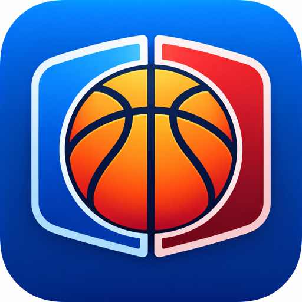

<p align="center">
  
</p>

<p align="center">
  <picture>
    <source media="(prefers-color-scheme: dark)" srcset="https://shieldcn.dev/header/glow.svg?title=Basketball+Scoreboard&subtitle=Keep+score+for+Home+and+Guest&logo=nba&mode=dark" />
    
  </picture>
</p>

<p align="center">
  <a href="https://ballscoreboardproject.netlify.app/"></a>
  <a href="https://github.com/thiernoyunus/basketball-scoreboard"></a>
  <a href="https://github.com/thiernoyunus/basketball-scoreboard"></a>
  <a href="https://github.com/thiernoyunus/basketball-scoreboard/stargazers"></a>
</p>

A two-team scoreboard (Home and Guest) with +1, +2 and +3 buttons for each team and a New Game button that resets both scores.

**Live demo:** <https://ballscoreboardproject.netlify.app/>

## Getting started

Install the dependencies and run the project:

```
npm install
npm start
```

## Built with

HTML, CSS and JavaScript, run with [Vite](https://vitejs.dev/) (see the Vite docs to learn more about configuring it).

## Credit

Built as part of a [Scrimba](https://scrimba.com/courses) course. More from Scrimba: [Frontend Career Path](https://scrimba.com/fullstack-path-c0fullstack) · [Scrimba Pro](https://scrimba.com/pricing)
